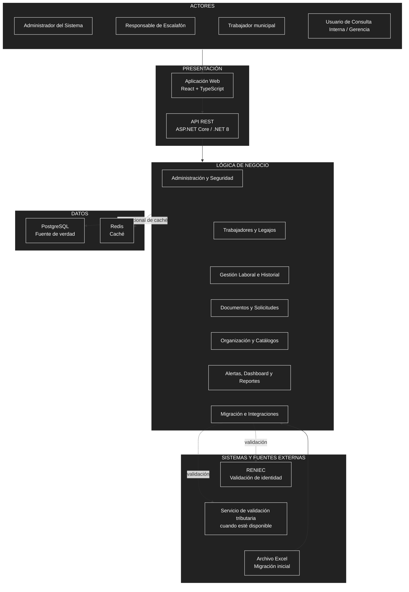

# Arquitectura inicial del sistema

## Diagrama de arquitectura

## Descripción

La arquitectura inicial del Sistema de Gestión Escalafonaria del Personal Municipal se organiza en presentación, lógica de negocio, datos e integraciones externas.

- **Actores:** participan el Administrador del Sistema, Responsable de Escalafón, Trabajador municipal y Usuario de Consulta Interna / Gerencia, cada uno con funciones y restricciones de acceso diferenciadas.
- **Presentación:** la interacción se realiza mediante una aplicación web desarrollada con React y TypeScript, que consume una API REST implementada con ASP.NET Core sobre .NET 8.
- **Lógica de negocio:** concentra las funcionalidades principales de administración y seguridad, trabajadores y legajos, gestión laboral e historial, documentos y solicitudes, organización y catálogos, alertas y reportes, además de migración e integraciones.
- **Datos:** PostgreSQL constituye la fuente de verdad de la información funcional e histórica. Redis se utiliza únicamente como apoyo para caché u optimización cuando sea necesario.
- **Integraciones externas:** RENIEC y el servicio de validación tributaria se consideran integraciones desacopladas y opcionales. La indisponibilidad de estos servicios no debe bloquear las operaciones principales del sistema.
- **Migración inicial:** la información existente en archivos Excel puede incorporarse mediante un proceso controlado de validación, previsualización y confirmación antes de persistirla en PostgreSQL.

La solución se implementa como un **monolito modular**, manteniendo la separación de responsabilidades definida por Clean Architecture.
