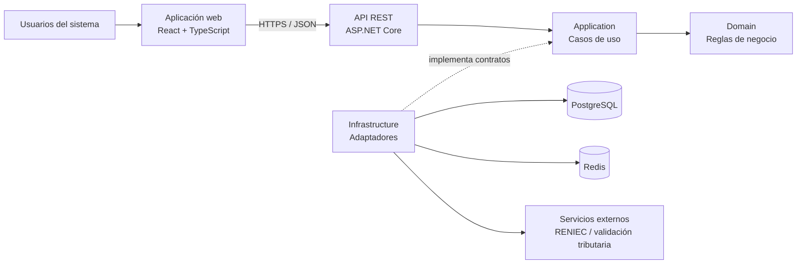

# Componentes arquitectónicos

Los componentes arquitectónicos representan las partes principales que conforman el Sistema de Gestión Escalafonaria del Personal Municipal y las responsabilidades que cumple cada una dentro de la solución.

| Componente | Responsabilidad principal | Tecnología / ubicación |
|---|---|---|
| Aplicación web | Proporcionar la interfaz mediante la cual los usuarios acceden a las funcionalidades del sistema según su rol y permisos. | React 18 + TypeScript + Vite |
| API REST | Recibir las solicitudes del frontend, aplicar autenticación y autorización, validar la entrada y exponer los casos de uso del sistema. | ASP.NET Core / .NET 8 – Capa API |
| Aplicación | Coordinar los casos de uso y definir los contratos necesarios para persistencia, caché e integraciones externas. | Capa Application |
| Dominio | Contener las entidades, reglas y conceptos centrales de la gestión escalafonaria, independientes de tecnologías externas. | Capa Domain |
| Infraestructura | Implementar acceso a datos, caché, almacenamiento documental e integraciones externas requeridas por la aplicación. | Capa Infrastructure |
| Base de datos | Almacenar la información oficial e histórica del sistema y actuar como fuente de verdad. | PostgreSQL |
| Caché | Apoyar la optimización de consultas cuando sea necesario, sin reemplazar la persistencia principal. | Redis |
| Integraciones externas | Permitir validaciones externas desacopladas del núcleo funcional del sistema. | Adaptadores para RENIEC y servicio de validación tributaria |

## Relación entre componentes

## Regla de dependencia

La dependencia del código debe orientarse hacia el núcleo del sistema:

- **Domain** no depende de ninguna otra capa.
- **Application** depende de Domain y define los contratos que necesita.
- **Infrastructure** depende de Application y Domain para implementar dichos contratos.
- **API** depende de Application e Infrastructure para exponer y ejecutar los casos de uso.
- La aplicación web se comunica con el backend únicamente mediante la API REST.

Esta organización permite mantener separadas las reglas del negocio de los detalles técnicos y facilita el mantenimiento y evolución del sistema.
