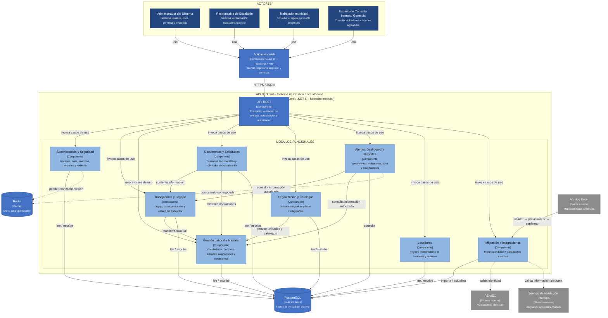

# Componentes arquitectónicos

## Diagrama de componentes – Sistema de Gestión Escalafonaria

**Modelo C4 – Nivel 3 (Componentes)**  
**Estilo arquitectónico:** Monolito modular organizado por capas.

## Descripción de los componentes

| Componente | Responsabilidad principal |
|---|---|
| **Aplicación Web** | Presenta las funcionalidades disponibles para cada actor y consume la API REST mediante HTTPS/JSON. |
| **API REST** | Expone los endpoints del sistema, recibe las solicitudes y aplica validación, autenticación y autorización antes de invocar los casos de uso. |
| **Administración y Seguridad** | Gestiona usuarios, roles, permisos, sesiones y registros de auditoría relacionados con la seguridad del sistema. |
| **Trabajadores y Legajos** | Gestiona la información principal del trabajador, el legajo escalafonario y su estado activo o pasivo. |
| **Gestión Laboral e Historial** | Administra vinculaciones laborales, contratos, adendas, asignaciones, movimientos y periodos de servicio. |
| **Documentos y Solicitudes** | Gestiona documentos sustentatorios y el flujo de solicitudes presentadas por los trabajadores. |
| **Organización y Catálogos** | Administra unidades orgánicas y listas configurables utilizadas por los demás módulos. |
| **Alertas, Dashboard y Reportes** | Calcula alertas de vencimiento y proporciona indicadores, ficha escalafonaria y reportes de acuerdo con los permisos del usuario. |
| **Locadores** | Gestiona de manera independiente los datos de locadores y sus servicios, sin convertirlos en legajos escalafonarios. |
| **Migración e Integraciones** | Ejecuta la migración inicial desde Excel y encapsula las validaciones externas mediante mecanismos desacoplados. |
| **PostgreSQL** | Es la fuente de verdad para la información oficial, histórica y transaccional del sistema. |
| **Redis** | Se utiliza únicamente como apoyo para caché u optimización cuando sea necesario. |

## Criterios arquitectónicos representados

- Los módulos forman parte de un **monolito modular** y se despliegan conjuntamente.
- El frontend se comunica con el backend exclusivamente mediante la **API REST**.
- La información oficial se conserva en **PostgreSQL**.
- **Redis** no sustituye a la base de datos principal.
- Las integraciones externas permanecen desacopladas del núcleo funcional.
- La indisponibilidad de RENIEC o del servicio de validación tributaria no debe bloquear las operaciones principales del sistema.
- Los permisos se validan en el backend y determinan qué información y operaciones puede utilizar cada actor.
