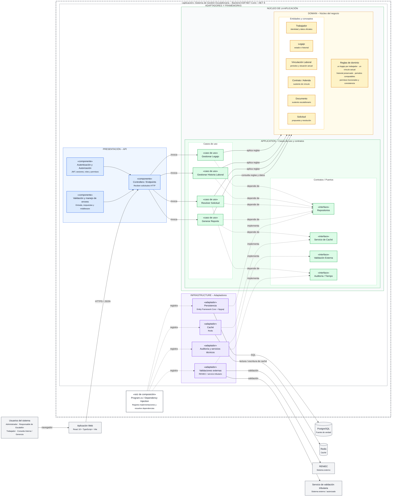

# Enfoque arquitectónico

## 1. Descripción

El Sistema de Gestión Escalafonaria del Personal Municipal adopta **Clean Architecture** para separar las reglas del negocio de los detalles de presentación, persistencia, caché e integraciones externas.

El backend se implementa como un **monolito modular** sobre ASP.NET Core / .NET 8. La dirección de las dependencias apunta hacia el núcleo: **Domain** no depende de otras capas, **Application** depende de Domain, **Infrastructure** implementa contratos definidos por Application y **API** expone los casos de uso.

## 2. Patrón seleccionado

| Aspecto | Descripción |
|---|---|
| Patrón arquitectónico | Clean Architecture |
| Estilo de implementación | Monolito modular |
| Objetivo | Mantener las reglas del negocio independientes de frameworks, base de datos e integraciones externas. |
| Capas principales | API, Application, Domain e Infrastructure |
| Regla principal | Las dependencias de código deben apuntar hacia Domain y Application. |
| Beneficio | Facilita mantenimiento, pruebas, evolución e incorporación de nuevas integraciones sin modificar el núcleo del negocio. |

## 3. Diagrama del enfoque arquitectónico

El siguiente diagrama representa la estructura del backend siguiendo una organización semejante a Clean Architecture, mostrando presentación, casos de uso, dominio, contratos, adaptadores e infraestructura.

## 4. Interpretación del diagrama

### Presentación

La capa **API** contiene los endpoints y mecanismos necesarios para recibir solicitudes, autenticar usuarios, aplicar autorización y validar datos de entrada. No contiene las reglas centrales del negocio.

### Application

La capa **Application** coordina los casos de uso del sistema. También define los contratos o puertos que necesita para acceder a persistencia, caché, auditoría e integraciones externas.

Entre los casos de uso representativos se encuentran:

- gestionar legajos;
- gestionar historia laboral;
- resolver solicitudes de actualización;
- generar reportes e indicadores.

### Domain

La capa **Domain** constituye el núcleo del negocio. Contiene entidades, conceptos y reglas relacionadas con trabajadores, legajos, vinculaciones laborales, contratos, documentos y solicitudes.

Esta capa no depende de ASP.NET Core, Entity Framework Core, PostgreSQL, Redis ni servicios externos.

### Infrastructure

La capa **Infrastructure** implementa los contratos definidos por Application. Incluye:

- persistencia mediante Entity Framework Core y PostgreSQL;
- acceso opcional a Redis;
- adaptadores para RENIEC y validación tributaria;
- implementaciones técnicas de auditoría y otros servicios de soporte.

### Raíz de composición

La configuración de **Dependency Injection** en ASP.NET Core registra qué implementación concreta satisface cada contrato. De esta manera, los casos de uso trabajan con abstracciones y no dependen directamente de tecnologías externas.

## 5. Leyenda

- **Flecha continua:** llamada o comunicación en tiempo de ejecución.
- **Flecha discontinua “depende de”:** dependencia hacia una abstracción.
- **Flecha discontinua “implementa”:** inversión de dependencias; Infrastructure implementa contratos definidos por Application.
- **Azul:** presentación.
- **Verde:** aplicación.
- **Amarillo:** dominio.
- **Morado:** infraestructura.
- **Gris:** tecnologías o sistemas externos.

## 6. Reglas de dependencia

1. **Domain** no depende de ninguna capa externa ni de frameworks.
2. **Application** depende de Domain y utiliza contratos para solicitar servicios externos.
3. **Infrastructure** implementa los contratos definidos por Application.
4. **API** invoca los casos de uso de Application y no accede directamente a PostgreSQL.
5. Los casos de uso no conocen implementaciones concretas de PostgreSQL, Redis, RENIEC ni otros servicios.
6. Cambiar una tecnología externa debe afectar principalmente Infrastructure y la configuración de dependencias, no las reglas del dominio.
