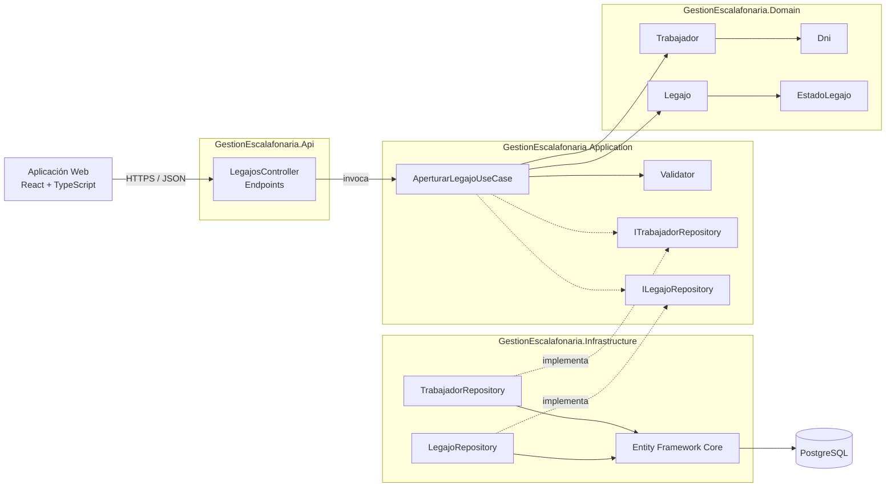
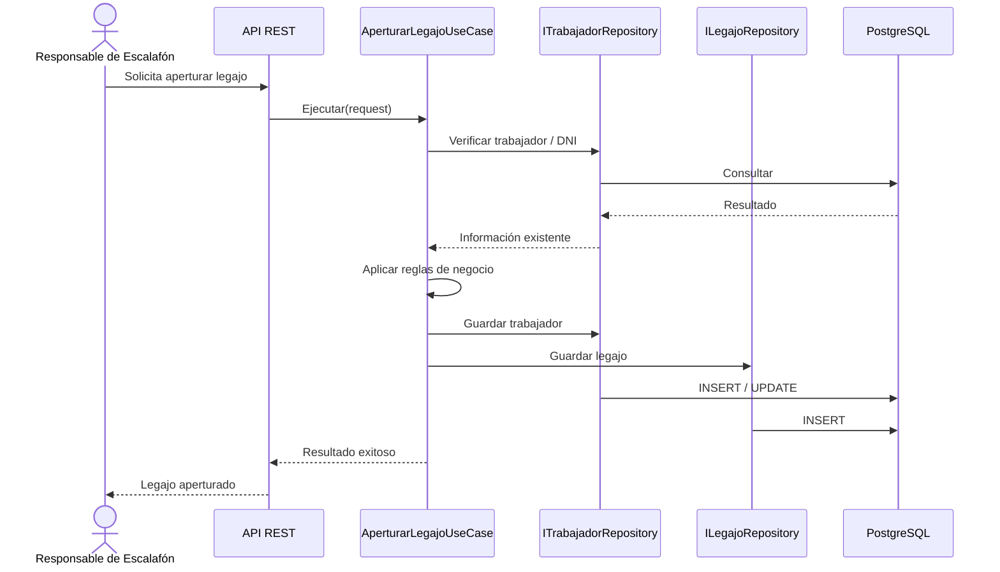

# Diseño interno de módulos

> **Proyecto:** Sistema de Gestión Escalafonaria del Personal Municipal  
> **Backend:** ASP.NET Core .NET 8 + C#  
> **Enfoque:** Clean Architecture dentro de un monolito modular  
> **Módulo de referencia:** M02 – Gestión de Trabajadores y Legajos

---

## 1. Propósito

Este documento describe cómo se organiza internamente el código del sistema y cómo los módulos funcionales se distribuyen entre las capas **API, Application, Domain e Infrastructure**.

El objetivo es que:

- las reglas del negocio permanezcan separadas de los detalles técnicos;
- los módulos mantengan responsabilidades claras;
- las dependencias apunten hacia el núcleo del sistema;
- las funcionalidades puedan evolucionar sin acoplarse directamente a PostgreSQL, Redis o servicios externos.

## 2. Módulos funcionales

El sistema se organiza en diez módulos funcionales:

| Código | Módulo |
|---|---|
| M01 | Administración y Seguridad |
| M02 | Gestión de Trabajadores y Legajos |
| M03 | Mi Legajo – Portal del Trabajador |
| M04 | Gestión Laboral e Historial |
| M05 | Gestión de Documentos Sustentatorios |
| M06 | Solicitudes y Validación |
| M07 | Organización y Listas de Referencia |
| M08 | Alertas |
| M09 | Reportes y Dashboard |
| M10 | Importación e Integraciones |

Los módulos no se despliegan como servicios independientes. Todos forman parte del mismo **monolito modular** y utilizan las capas arquitectónicas comunes. fileciteturn281file1L74-L108

## 3. Organización general del backend

```text
backend/
├── src/
│   ├── GestionEscalafonaria.Api/
│   │   ├── Controllers/
│   │   ├── Middlewares/
│   │   ├── Filters/
│   │   ├── Extensions/
│   │   └── Configuration/
│   │
│   ├── GestionEscalafonaria.Application/
│   │   ├── DTOs/
│   │   ├── Interfaces/
│   │   ├── Services/
│   │   ├── Validators/
│   │   └── Mappings/
│   │
│   ├── GestionEscalafonaria.Domain/
│   │   ├── Entities/
│   │   ├── ValueObjects/
│   │   ├── Enums/
│   │   ├── Interfaces/
│   │   └── Exceptions/
│   │
│   └── GestionEscalafonaria.Infrastructure/
│       ├── Persistence/
│       ├── Repositories/
│       ├── Cache/
│       ├── Storage/
│       ├── ExternalServices/
│       └── Configurations/
│
└── tests/
    └── GestionEscalafonaria.Tests/
        ├── Unit/
        └── Integration/
```

La infraestructura base establece las siguientes dependencias:

- **Api → Application + Infrastructure**
- **Application → Domain**
- **Infrastructure → Application + Domain**
- **Domain → ninguna capa externa**

Esta organización corresponde a la estructura técnica definida para la solución. fileciteturn281file0

## 4. Módulo de referencia: Gestión de Trabajadores y Legajos

El módulo M02 se utiliza como referencia porque concentra reglas centrales del sistema, como la apertura del legajo, consulta de trabajadores, actualización de información oficial y conservación del historial.

### 4.1 Domain

Contiene las entidades, objetos de valor y reglas del negocio.

**Elementos representativos:**

- `Trabajador`
- `Legajo`
- `Dni`
- `EstadoLegajo`
- excepciones y reglas de dominio

Responsabilidades principales:

- representar al trabajador municipal;
- mantener la identidad del legajo;
- controlar estados ACTIVO/PASIVO;
- preservar reglas de consistencia e historial;
- impedir que las reglas centrales dependan de tecnologías externas.

### 4.2 Application

Coordina los casos de uso del módulo.

**Casos de uso representativos:**

- `AperturarLegajoUseCase`
- búsqueda y consulta de trabajadores;
- actualización de información oficial;
- reactivación o cambio de estado del legajo.

También contiene:

- DTO de entrada y salida;
- validadores;
- interfaces de repositorios;
- interfaces para servicios requeridos por los casos de uso.

El diseño aprobado define explícitamente los casos de uso por módulo y los contratos necesarios para infraestructura. fileciteturn281file1L94-L108

### 4.3 Infrastructure

Implementa los contratos definidos por las capas internas.

**Elementos representativos:**

- repositorio de trabajadores;
- repositorio de legajos;
- configuraciones de Entity Framework Core;
- `GestionEscalafonariaDbContext`;
- acceso a PostgreSQL;
- servicios técnicos que sean necesarios.

Infrastructure conoce las tecnologías concretas, mientras Application y Domain trabajan con abstracciones.

### 4.4 API

Expone las operaciones del módulo mediante HTTP.

**Responsabilidades:**

- recibir las solicitudes;
- aplicar autorización;
- validar la entrada;
- invocar el caso de uso correspondiente;
- devolver una respuesta HTTP apropiada;
- ejecutar middleware de auditoría y manejo de errores.

La API se organiza mediante controladores por módulo, políticas de autorización, filtros y middlewares. fileciteturn281file1L111-L116

## 5. Relación interna entre capas



## 6. Regla de dependencia

| Capa | Responsabilidad | Puede depender de | No debe depender directamente de |
|---|---|---|---|
| **Domain** | Entidades y reglas del negocio | Elementos del propio dominio | API, Infrastructure, EF Core, PostgreSQL, Redis |
| **Application** | Casos de uso y contratos | Domain | API e implementaciones concretas de Infrastructure |
| **Infrastructure** | Persistencia e integraciones | Application y Domain | Presentación web |
| **API** | Exposición HTTP y composición | Application e Infrastructure | Reglas de negocio implementadas directamente en controladores |

La regla principal es que el **núcleo del negocio no debe conocer los detalles tecnológicos**.

## 7. Ejemplo de flujo: apertura de legajo



El flujo mantiene la separación de responsabilidades: el controlador no guarda datos directamente, el caso de uso coordina la operación y los repositorios abstraen la persistencia. El diseño técnico aprobado utiliza este mismo esquema para la apertura de legajos. fileciteturn281file1L3696-L3710

## 8. Organización del frontend

El frontend se estructura por funcionalidades utilizando `features/`. Entre las áreas previstas se encuentran autenticación, trabajadores, legajos, gestión laboral, solicitudes, reportes y otras funcionalidades del sistema.

Cada feature puede contener sus propios componentes, servicios, hooks, páginas y estado cuando corresponda. El diseño aprobado utiliza esta organización por funcionalidades para el frontend React. fileciteturn281file1L2542-L2556

## 9. Resultado del diseño interno

La organización propuesta permite que cada funcionalidad tenga una ubicación clara y respete Clean Architecture. La incorporación de una nueva regla funcional debe afectar principalmente Domain y Application, mientras que un cambio de tecnología de persistencia o integración debe concentrarse principalmente en Infrastructure.
