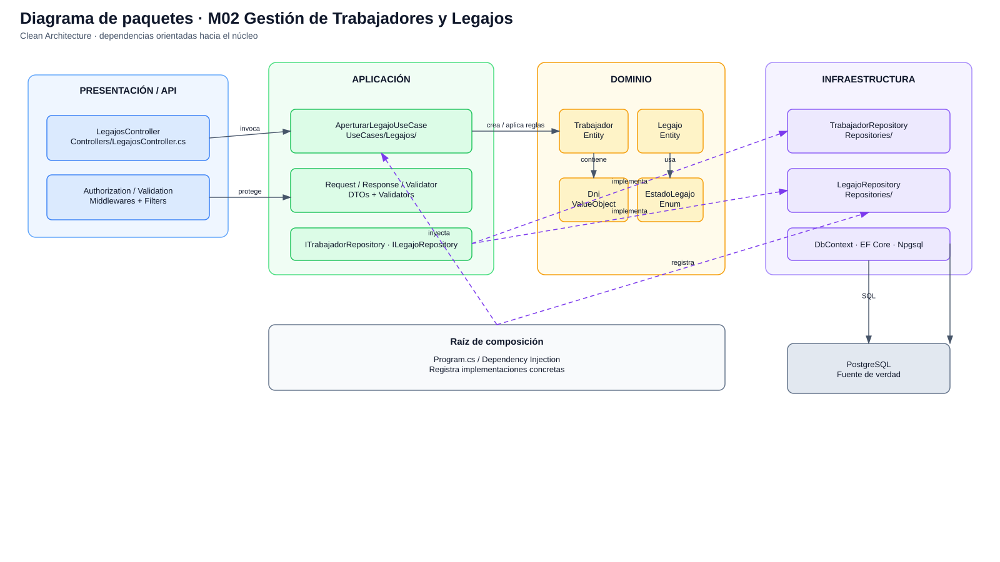

# Diseño interno de módulos

> **Proyecto:** Sistema de Gestión Escalafonaria del Personal Municipal  
> **Backend:** ASP.NET Core .NET 8 + C#  
> **Módulo de referencia:** M02 – Gestión de Trabajadores y Legajos  
> **Enfoque arquitectónico:** Clean Architecture dentro de un monolito modular  
> **Nivel C4:** 4 – Código · **Versión:** 1.0

---

## 1. Propósito

Este documento describe **cómo se organiza el código dentro de un módulo del backend**. Tiene tres objetivos:

- que los módulos mantengan una estructura interna uniforme;
- que las reglas del negocio permanezcan aisladas de la tecnología;
- que cualquier integrante del equipo identifique dónde se ubica cada responsabilidad y de qué puede depender.

El sistema se organiza en los módulos funcionales M01–M10, pero en este documento se utiliza como referencia **M02 – Gestión de Trabajadores y Legajos**, por contener reglas centrales como apertura de legajo, consulta de trabajadores, actualización de información oficial y conservación del historial. fileciteturn281file3

## 2. Estructura de carpetas

La solución conserva los cuatro proyectos principales definidos en la infraestructura base:

```text
backend/
└── src/
    ├── GestionEscalafonaria.Api/
    │   ├── Controllers/
    │   │   └── LegajosController.cs
    │   ├── Middlewares/
    │   ├── Filters/
    │   ├── Extensions/
    │   └── Configuration/
    │
    ├── GestionEscalafonaria.Application/
    │   ├── DTOs/
    │   │   └── Legajos/
    │   │       ├── AperturarLegajoRequest.cs
    │   │       └── AperturarLegajoResponse.cs
    │   ├── Interfaces/
    │   │   ├── ITrabajadorRepository.cs
    │   │   └── ILegajoRepository.cs
    │   ├── Services/
    │   │   └── Legajos/
    │   │       └── AperturarLegajoUseCase.cs
    │   ├── Validators/
    │   │   └── AperturarLegajoRequestValidator.cs
    │   └── Mappings/
    │
    ├── GestionEscalafonaria.Domain/
    │   ├── Entities/
    │   │   ├── Trabajador.cs
    │   │   └── Legajo.cs
    │   ├── ValueObjects/
    │   │   └── Dni.cs
    │   ├── Enums/
    │   │   └── EstadoLegajo.cs
    │   ├── Interfaces/
    │   └── Exceptions/
    │
    └── GestionEscalafonaria.Infrastructure/
        ├── Persistence/
        │   └── GestionEscalafonariaDbContext.cs
        ├── Repositories/
        │   ├── TrabajadorRepository.cs
        │   └── LegajoRepository.cs
        ├── Cache/
        ├── Storage/
        ├── ExternalServices/
        └── Configurations/
```

La infraestructura aprobada establece las dependencias **Api → Application + Infrastructure**, **Application → Domain**, **Infrastructure → Application + Domain** y **Domain sin dependencias externas**. fileciteturn281file0

| Archivo / elemento | Capa | Responsabilidad | Depende de |
|---|---|---|---|
| `Trabajador.cs` | Dominio | Representar al trabajador y proteger sus reglas principales. | Solo dominio |
| `Legajo.cs` | Dominio | Representar el expediente escalafonario y su estado ACTIVO/PASIVO. | Solo dominio |
| `Dni.cs` | Dominio | Representar y validar el DNI como objeto de valor. | Nada externo |
| `EstadoLegajo.cs` | Dominio | Definir los estados válidos del legajo. | Nada externo |
| `ITrabajadorRepository.cs` | Aplicación | Declarar las operaciones de persistencia requeridas sobre trabajadores. | Dominio |
| `ILegajoRepository.cs` | Aplicación | Declarar las operaciones de persistencia requeridas sobre legajos. | Dominio |
| `AperturarLegajoUseCase.cs` | Aplicación | Coordinar la validación y creación de Trabajador + Legajo. | Dominio + contratos |
| `AperturarLegajoRequestValidator.cs` | Aplicación | Validar formato y unicidad necesaria antes del caso de uso. | Contratos de aplicación |
| `TrabajadorRepository.cs` | Infraestructura | Implementar persistencia de trabajadores con EF Core. | Application + Domain + EF Core |
| `LegajoRepository.cs` | Infraestructura | Implementar persistencia de legajos con EF Core. | Application + Domain + EF Core |
| `LegajosController.cs` | API | Traducir HTTP a una llamada del caso de uso y devolver la respuesta. | Application |
| `Program.cs` | Composición | Registrar implementaciones concretas mediante Dependency Injection. | Todas las capas necesarias |

---

## 3. Capas del módulo y regla de dependencia



**Regla de dependencia:** el código debe mantener las reglas del negocio independientes de ASP.NET Core, Entity Framework Core, PostgreSQL, Redis y servicios externos.

| Capa | Contiene | Responsabilidad | Puede depender de | **No** debe depender directamente de |
|---|---|---|---|---|
| **Domain** | Entidades, objetos de valor, enums, excepciones | Reglas e invariantes del negocio escalafonario | Elementos del propio dominio | API, Infrastructure, EF Core, PostgreSQL, Redis |
| **Application** | Casos de uso, DTO, contratos, validadores, mappings | Orquestar cada operación del sistema | Domain | Implementaciones concretas de Infrastructure |
| **Infrastructure** | Repositorios, DbContext, caché, storage, adaptadores externos | Implementar contratos utilizando tecnologías concretas | Application, Domain y librerías técnicas | Presentación web |
| **API** | Controllers, middleware, filtros, políticas | Traducir solicitudes HTTP y ejecutar casos de uso | Application e Infrastructure para composición | Reglas de negocio embebidas en controladores |
| **Composición** | `Program.cs` y configuración DI | Elegir implementaciones concretas y registrarlas | Todas las capas necesarias | — |

> **Cómo comprobarlo en el código:** si una entidad de `GestionEscalafonaria.Domain` importa EF Core, Npgsql, ASP.NET Core, Redis o una clase concreta de Infrastructure, la regla de dependencia se está rompiendo.

---

## 4. Diagrama de clases


El diagrama representa las clases principales relacionadas con el caso de uso **Aperturar Legajo**. El diseño aprobado establece que un trabajador tiene un único legajo y que el legajo conserva su estado e historial. Personal_Inversiones no se modela como un booleano permanente del trabajador, sino como asociación histórica cuando corresponda. fileciteturn281file3

### 4.1 Notación UML utilizada

| Símbolo | Significado | Ejemplo en el diagrama |
|---|---|---|
| Línea continua con flecha | Asociación o uso directo entre clases | `LegajosController → AperturarLegajoUseCase` |
| Línea discontinua | Dependencia temporal o creación | `AperturarLegajoUseCase → Trabajador` |
| Línea discontinua hacia interfaz | Realización / implementación de contrato | `TrabajadorRepository → ITrabajadorRepository` |
| Relación 1:1 | Asociación única entre entidades | `Trabajador ↔ Legajo` |
| «interface» | Contrato sin implementación concreta | `ITrabajadorRepository`, `ILegajoRepository` |
| «value object» | Objeto definido por su valor | `Dni` |
| «enumeration» | Conjunto cerrado de valores | `EstadoLegajo` |

---

## 5. Flujo de ejecución: Aperturar legajo


El flujo de apertura valida el DNI, evita que exista un segundo legajo para el mismo trabajador y revisa si el DNI aparece como locador. La existencia como locador se considera una advertencia informativa y no bloquea la creación del trabajador con legajo. fileciteturn281file3

| Paso | Origen → destino | Acción | Capa |
|---|---|---|---|
| 1 | Responsable de Escalafón → `LegajosController` | Solicita aperturar un legajo enviando el DNI. | Presentación / API |
| 2 | `LegajosController` → Validator | Valida formato del DNI y reglas de entrada. | API → Application |
| 3 | `LegajosController` → `AperturarLegajoUseCase` | Ejecuta el caso de uso. | API → Application |
| 4 | Caso de uso → `ITrabajadorRepository` | Verifica si ya existe un trabajador con legajo para el DNI. | Application → contrato |
| 5 | Repositorio → PostgreSQL | Consulta la información existente. | Infrastructure → datos |
| 6 | Caso de uso → repositorio de locadores | Verifica si el DNI existe como locador; solo genera advertencia. | Application → contrato |
| 7 | Caso de uso → `ILegajoRepository` | Obtiene o genera el código de legajo correspondiente. | Application → contrato |
| 8 | Caso de uso → `ITrabajadorRepository` | Registra el trabajador. | Application → contrato |
| 9 | Caso de uso → `ILegajoRepository` | Registra el legajo asociado. | Application → contrato |
| 10 | Infraestructura → PostgreSQL | Persiste la operación conservando consistencia. | Infrastructure → datos |
| 11 | Caso de uso → Controller | Devuelve identificadores y código del legajo. | Application → API |
| 12 | Controller → Responsable | Responde con creación exitosa. | API |

---

## 6. Código de referencia

Los siguientes fragmentos muestran **cómo se aplicará la separación por capas**. Son código de referencia del diseño y pueden ajustarse durante la implementación sin alterar las reglas arquitectónicas.

### 6.1 Dominio · entidad y objeto de valor

```csharp
// Domain/ValueObjects/Dni.cs
public sealed record Dni
{
    public string Valor { get; }

    private Dni(string valor) => Valor = valor;

    public static Dni Crear(string valor)
    {
        if (string.IsNullOrWhiteSpace(valor) ||
            valor.Length != 8 ||
            !valor.All(char.IsDigit))
        {
            throw new DomainException("El DNI debe contener exactamente 8 dígitos.");
        }

        return new Dni(valor);
    }
}
```

```csharp
// Domain/Entities/Trabajador.cs
public class Trabajador
{
    public Guid Id { get; private set; }
    public Dni Dni { get; private set; }

    private Trabajador() { }

    private Trabajador(Guid id, Dni dni)
    {
        Id = id;
        Dni = dni;
    }

    public static Trabajador Crear(Dni dni)
        => new(Guid.NewGuid(), dni);
}
```

```csharp
// Domain/Entities/Legajo.cs
public class Legajo
{
    public Guid Id { get; private set; }
    public Guid TrabajadorId { get; private set; }
    public string Codigo { get; private set; }
    public EstadoLegajo Estado { get; private set; }

    private Legajo() { }

    public static Legajo Crear(Guid trabajadorId, string codigo)
        => new()
        {
            Id = Guid.NewGuid(),
            TrabajadorId = trabajadorId,
            Codigo = codigo,
            Estado = EstadoLegajo.ACTIVO
        };

    public void PasarAPasivo() => Estado = EstadoLegajo.PASIVO;
    public void Reactivar() => Estado = EstadoLegajo.ACTIVO;
}
```

### 6.2 Aplicación · contratos

```csharp
// Application/Interfaces/ITrabajadorRepository.cs
public interface ITrabajadorRepository
{
    Task<bool> ExisteTrabajadorConLegajoPorDniAsync(
        string dni,
        CancellationToken cancellationToken = default);

    Task AddAsync(
        Trabajador trabajador,
        CancellationToken cancellationToken = default);
}
```

```csharp
// Application/Interfaces/ILegajoRepository.cs
public interface ILegajoRepository
{
    Task<string> GenerarCodigoAsync(
        CancellationToken cancellationToken = default);

    Task AddAsync(
        Legajo legajo,
        CancellationToken cancellationToken = default);
}
```

### 6.3 Aplicación · caso de uso

El request oficial de apertura contiene únicamente el DNI. Personal_Inversiones se registra después como asociación histórica cuando corresponda. fileciteturn281file3

```csharp
public sealed class AperturarLegajoRequest
{
    public string Dni { get; set; } = string.Empty;
}

public sealed class AperturarLegajoResponse
{
    public Guid TrabajadorId { get; set; }
    public Guid LegajoId { get; set; }
    public string CodigoLegajo { get; set; } = string.Empty;
    public string Dni { get; set; } = string.Empty;
}
```

```csharp
public sealed class AperturarLegajoUseCase
{
    private readonly ITrabajadorRepository _trabajadores;
    private readonly ILegajoRepository _legajos;
    private readonly ILocadorRepository _locadores;

    public AperturarLegajoUseCase(
        ITrabajadorRepository trabajadores,
        ILegajoRepository legajos,
        ILocadorRepository locadores)
    {
        _trabajadores = trabajadores;
        _legajos = legajos;
        _locadores = locadores;
    }

    public async Task<AperturarLegajoResponse> EjecutarAsync(
        AperturarLegajoRequest request,
        CancellationToken cancellationToken = default)
    {
        var dni = Dni.Crear(request.Dni);

        if (await _trabajadores.ExisteTrabajadorConLegajoPorDniAsync(
            dni.Valor, cancellationToken))
        {
            throw new BusinessRuleException(
                "Ya existe un trabajador con legajo para este DNI.");
        }

        // Si existe como locador se registra/retorna una advertencia,
        // pero no se impide la apertura del legajo.
        _ = await _locadores.ExistePorDniAsync(dni.Valor, cancellationToken);

        var trabajador = Trabajador.Crear(dni);
        var codigo = await _legajos.GenerarCodigoAsync(cancellationToken);
        var legajo = Legajo.Crear(trabajador.Id, codigo);

        await _trabajadores.AddAsync(trabajador, cancellationToken);
        await _legajos.AddAsync(legajo, cancellationToken);

        return new AperturarLegajoResponse
        {
            TrabajadorId = trabajador.Id,
            LegajoId = legajo.Id,
            CodigoLegajo = legajo.Codigo,
            Dni = trabajador.Dni.Valor
        };
    }
}
```

### 6.4 Infraestructura · repositorio

```csharp
// Infrastructure/Repositories/TrabajadorRepository.cs
public sealed class TrabajadorRepository : ITrabajadorRepository
{
    private readonly GestionEscalafonariaDbContext _db;

    public TrabajadorRepository(GestionEscalafonariaDbContext db)
        => _db = db;

    public Task<bool> ExisteTrabajadorConLegajoPorDniAsync(
        string dni,
        CancellationToken cancellationToken = default)
    {
        return _db.Trabajadores
            .AnyAsync(
                t => t.Dni == dni && t.Legajo != null,
                cancellationToken);
    }

    public async Task AddAsync(
        Trabajador trabajador,
        CancellationToken cancellationToken = default)
    {
        await _db.Trabajadores.AddAsync(trabajador, cancellationToken);
    }
}
```

> La confirmación de los cambios debe realizarse dentro de la unidad de trabajo/transacción definida para la operación, de modo que Trabajador y Legajo no queden en un estado parcial inconsistente.

### 6.5 Presentación · controlador

```csharp
// Api/Controllers/LegajosController.cs
[ApiController]
[Route("api/legajos")]
public sealed class LegajosController : ControllerBase
{
    private readonly AperturarLegajoUseCase _aperturarLegajo;

    public LegajosController(AperturarLegajoUseCase aperturarLegajo)
        => _aperturarLegajo = aperturarLegajo;

    [HttpPost("aperturar")]
    public async Task<IActionResult> Aperturar(
        [FromBody] AperturarLegajoRequest request,
        CancellationToken cancellationToken)
    {
        var response = await _aperturarLegajo
            .EjecutarAsync(request, cancellationToken);

        return CreatedAtAction(
            nameof(Aperturar),
            new { id = response.LegajoId },
            response);
    }
}
```

### 6.6 Raíz de composición

```csharp
// Api/Program.cs
builder.Services.AddScoped<ITrabajadorRepository, TrabajadorRepository>();
builder.Services.AddScoped<ILegajoRepository, LegajoRepository>();
builder.Services.AddScoped<ILocadorRepository, LocadorRepository>();

builder.Services.AddScoped<AperturarLegajoUseCase>();
```

La inversión de dependencias permite que el caso de uso conozca únicamente interfaces; PostgreSQL y Entity Framework Core permanecen en Infrastructure.

---

## 7. Resultado del diseño interno

El módulo M02 muestra el patrón que deben seguir los demás módulos: **API recibe**, **Application coordina**, **Domain protege las reglas** e **Infrastructure implementa los detalles técnicos**. Esto permite evolucionar la gestión escalafonaria sin trasladar reglas de negocio a controladores, repositorios o frameworks.
