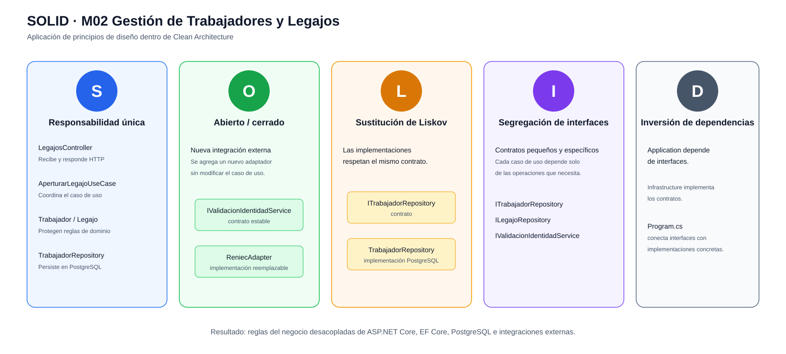

# Principios de diseño (SOLID)

## Objetivo

Documentar cómo se aplican los principios SOLID en el backend del Sistema de Gestión Escalafonaria del Personal Municipal, organizado con Clean Architecture, para que los módulos se desarrollen de forma uniforme y las reglas del negocio no dependan directamente de la tecnología.

## Contexto

- **Estilo:** monolito modular (ASP.NET Core / .NET 8).
- **Enfoque interno:** Clean Architecture (API, Application, Domain e Infrastructure).
- **Módulo de referencia:** M02 – Gestión de Trabajadores y Legajos, porque concentra reglas centrales del sistema y utiliza persistencia, validaciones y casos de uso.

## SOLID en el módulo Gestión de Trabajadores y Legajos

| Principio | Dónde se aplica (capa) | Cómo se cumple en el Sistema Escalafonario | Archivos / elementos |
|---|---|---|---|
| **S** · Responsabilidad única | Todas las capas | Cada elemento tiene una responsabilidad definida: el controlador recibe la petición HTTP, el caso de uso coordina la operación, las entidades aplican reglas del negocio y los repositorios gestionan la persistencia. | `LegajosController.cs`, `AperturarLegajoUseCase.cs`, `Trabajador.cs`, `Legajo.cs`, `TrabajadorRepository.cs` |
| **O** · Abierto/cerrado | Application / Infrastructure | Una nueva implementación de persistencia o validación externa puede incorporarse mediante un nuevo adaptador o repositorio sin modificar las reglas centrales del caso de uso. | `ITrabajadorRepository`, `IValidacionIdentidadService`, `ReniecAdapter` |
| **L** · Sustitución de Liskov | Infrastructure | Las implementaciones concretas deben respetar el contrato definido por sus interfaces, de modo que puedan sustituirse sin alterar el comportamiento esperado por los casos de uso. | `ITrabajadorRepository`, `TrabajadorRepository`, contratos de servicios externos |
| **I** · Segregación de interfaces | Application | Cada interfaz expone únicamente las operaciones que necesita el caso de uso, evitando contratos generales con responsabilidades no relacionadas. | `ITrabajadorRepository`, `ILegajoRepository`, `IValidacionIdentidadService` |
| **D** · Inversión de dependencias | Application / composición | Los casos de uso dependen de interfaces y no de Entity Framework Core, PostgreSQL o proveedores externos; las implementaciones concretas se conectan mediante Dependency Injection. | `AperturarLegajoUseCase.cs`, `Program.cs`, repositorios y adaptadores de Infrastructure |

## Qué pasaría sin SOLID en el Sistema Escalafonario

| Situación real | Sin SOLID | Con SOLID |
|---|---|---|
| Se cambia la forma de persistir trabajadores o legajos | Habría que modificar los casos de uso y posiblemente controladores | Se reemplaza o ajusta la implementación del repositorio |
| Se cambia el proveedor de validación de identidad | La lógica del caso de uso quedaría acoplada al proveedor externo | Se implementa otro adaptador que respete el mismo contrato |
| Se quiere probar la apertura de un legajo | La prueba necesitaría conectarse obligatoriamente a PostgreSQL | Se pueden utilizar implementaciones simuladas de los repositorios |
| Cambia una regla del legajo | La regla podría estar repartida entre controlador, repositorio y servicios técnicos | La regla permanece concentrada en Domain y en el caso de uso correspondiente |

## Relación con Clean Architecture y los patrones

| Principio | Lo cumple en el proyecto |
|---|---|
| Responsabilidad única | La separación entre API, Application, Domain e Infrastructure |
| Abierto/cerrado y Liskov | El patrón Adapter y los contratos de repositorios y servicios externos |
| Segregación de interfaces | Interfaces específicas como `ITrabajadorRepository`, `ILegajoRepository` e `IValidacionIdentidadService` |
| Inversión de dependencias | Repository, Adapter y Dependency Injection; Infrastructure implementa contratos definidos hacia el núcleo |
