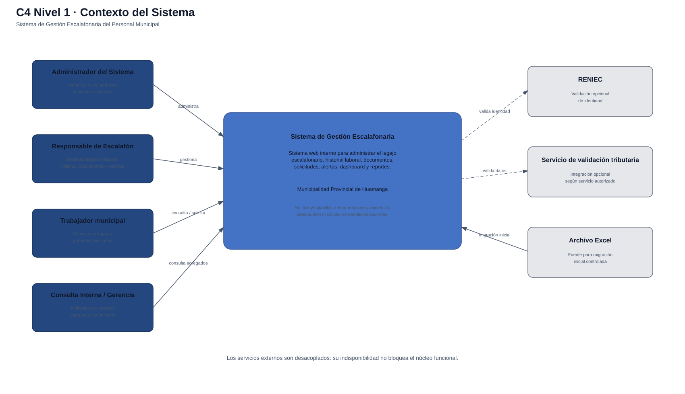

# Nivel 1 · Diagrama de contexto del sistema

> **Proyecto:** Sistema de Gestión Escalafonaria del Personal Municipal  
> **Modelo:** C4 · Nivel 1 de 4 · **Versión:** 1.0

---

## 1. Objetivo

Mostrar el **Sistema de Gestión Escalafonaria como una sola caja**, identificando quiénes lo utilizan y con qué sistemas o fuentes externas se comunica.

| Aspecto | Descripción |
|---|---|
| Pregunta que responde | ¿Qué es el sistema, quién lo usa y con qué sistemas externos se relaciona? |
| Audiencia | Docente, responsables funcionales, usuarios y equipo de desarrollo |
| Qué **no** muestra | Tecnologías, servidores, bases de datos ni módulos internos |
| Siguiente nivel | `Nivel2-DiagramadeContenedores.md` |

---

## 2. Diagrama

---

## 3. Personas

| Persona | Descripción | Qué hace en el sistema |
|---|---|---|
| **Administrador del Sistema** | Responsable de la administración técnica y de acceso | Gestiona usuarios, roles, permisos, sesiones y auditoría. No obtiene acceso automático a legajos por ser administrador |
| **Responsable de Escalafón** | Principal actor funcional | Gestiona legajos oficiales, historial laboral, documentos, solicitudes, alertas y reportes autorizados |
| **Trabajador municipal** | Persona con legajo escalafonario | Consulta su propio legajo, visualiza documentos habilitados y presenta solicitudes de actualización |
| **Usuario de Consulta Interna / Gerencia** | Usuario de consulta gerencial | Consulta únicamente indicadores, dashboard y reportes agregados autorizados |

---

## 4. Sistemas y fuentes externas

| Sistema / fuente | Tipo | Responsabilidad |
|---|---|---|
| **Sistema de Gestión Escalafonaria** | Sistema en alcance | Centraliza y administra la información escalafonaria del personal municipal |
| **RENIEC** | Sistema externo | Permite validar identidad mediante DNI cuando el servicio autorizado esté disponible |
| **Servicio de validación tributaria** | Sistema externo | Permite realizar validaciones tributarias cuando exista un servicio oficial/autorizado disponible |
| **Archivo Excel** | Fuente externa | Proporciona información para la migración inicial mediante un proceso controlado |

---

## 5. Relaciones

| Origen | Destino | Descripción |
|---|---|---|
| Administrador del Sistema | Sistema Escalafonario | Administra usuarios, roles, permisos y seguridad |
| Responsable de Escalafón | Sistema Escalafonario | Registra, actualiza y consulta información oficial del legajo |
| Trabajador municipal | Sistema Escalafonario | Consulta su información y presenta solicitudes |
| Consulta Interna / Gerencia | Sistema Escalafonario | Consulta indicadores y reportes agregados |
| Sistema Escalafonario | RENIEC | Solicita validación opcional de identidad |
| Sistema Escalafonario | Servicio tributario | Solicita validación externa opcional |
| Archivo Excel | Sistema Escalafonario | Proporciona información para validar, previsualizar y confirmar una migración |

---

## 6. Decisiones y supuestos

| # | Decisión o supuesto | Motivo |
|---|---|---|
| 1 | RENIEC y la validación tributaria son integraciones desacopladas | La indisponibilidad externa no debe bloquear el núcleo funcional |
| 2 | Excel no funciona como base de datos | Después de la migración, PostgreSQL se convierte en la fuente de verdad |
| 3 | El Usuario de Consulta no accede a legajos individuales | Su alcance se limita a información agregada |
| 4 | El Administrador no obtiene acceso funcional a legajos por defecto | La administración técnica y la gestión escalafonaria son responsabilidades diferentes |
