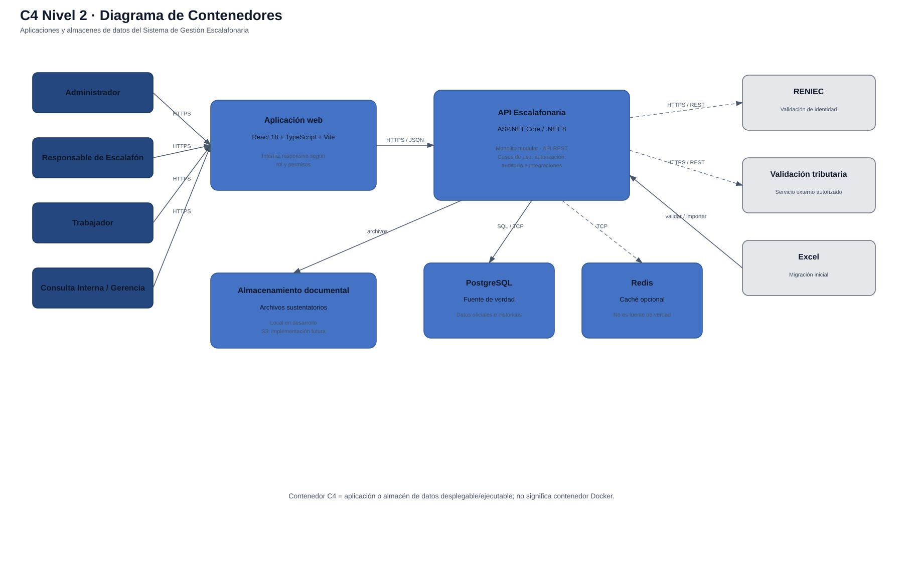

# Nivel 2 · Diagrama de contenedores

> **Proyecto:** Sistema de Gestión Escalafonaria del Personal Municipal  
> **Modelo:** C4 · Nivel 2 de 4 · **Versión:** 1.0

---

## 1. Objetivo

Abrir la caja del sistema mostrada en el nivel 1 y representar los **contenedores** principales: aplicaciones y almacenes de datos que forman la solución, junto con sus tecnologías y relaciones.

| Aspecto | Descripción |
|---|---|
| Pregunta que responde | ¿De qué piezas ejecutables y almacenes de datos se compone el sistema? |
| Audiencia | Arquitectos, desarrolladores y operaciones |
| Qué es un contenedor | Una aplicación o almacén de datos que se ejecuta o persiste información de manera independiente |
| Nivel anterior | `Nivel1-DiagramadeContextodelSistema.md` |
| Siguiente nivel | `Nivel3-Diagrama-de-Componentes.md` |

---

## 2. Diagrama

---

## 3. Contenedores

| Contenedor | Tecnología | Responsabilidad | Datos que maneja |
|---|---|---|---|
| **Aplicación web** | React 18 + TypeScript + Vite | Proporciona la interfaz responsiva para los cuatro actores | Estado temporal de interfaz y sesión del usuario |
| **API Escalafonaria** | ASP.NET Core / .NET 8 | Expone la API REST, ejecuta casos de uso, aplica autorización, reglas de negocio e integraciones | No posee almacenamiento propio; utiliza los contenedores de datos |
| **Base de datos** | PostgreSQL 15 | Fuente de verdad de la información oficial e histórica | Trabajadores, legajos, vínculos, contratos, documentos, solicitudes, auditoría y catálogos |
| **Caché** | Redis 7 | Optimización opcional para sesiones, permisos o consultas repetitivas | Copias temporales y reconstruibles |
| **Almacenamiento documental** | Sistema de archivos en desarrollo; almacenamiento externo futuro | Conserva los archivos sustentatorios asociados al legajo | PDF, imágenes, documentos y otros formatos permitidos |

---

## 4. Relaciones

| Origen | Destino | Descripción | Protocolo |
|---|---|---|---|
| Usuarios | Aplicación web | Utilizan el sistema mediante navegador | HTTPS |
| Aplicación web | API Escalafonaria | Consume funcionalidades del sistema | HTTPS / JSON |
| API Escalafonaria | PostgreSQL | Lee y escribe información oficial | SQL / TCP |
| API Escalafonaria | Redis | Lee y escribe información temporal cacheable | TCP |
| API Escalafonaria | Almacenamiento documental | Guarda y recupera documentos sustentatorios | Acceso interno / servicio de almacenamiento |
| API Escalafonaria | RENIEC | Validación opcional de identidad | HTTPS / REST |
| API Escalafonaria | Servicio tributario | Validación opcional | HTTPS / REST |
| Excel | API Escalafonaria | Proporciona registros para la migración inicial | Carga de archivo |

---

## 5. Decisiones arquitectónicas reflejadas

| Decisión | Alternativa descartada | Motivo |
|---|---|---|
| Backend como monolito modular | Microservicios | Reduce complejidad operativa y mantiene separación modular suficiente para la versión actual |
| Frontend separado del backend | Aplicación acoplada al servidor | Permite separar interfaz y lógica mediante API REST |
| PostgreSQL como fuente de verdad | Excel o Redis como persistencia principal | La información escalafonaria requiere integridad, relaciones e historial |
| Redis como caché opcional | Dependencia obligatoria de caché | La consistencia del sistema no debe depender de Redis |
| Integraciones externas solo desde backend | Consumir servicios externos desde el navegador | Protege credenciales y mantiene desacoplamiento |

---

## 6. Seguridad entre contenedores

| Comunicación | Medida |
|---|---|
| Navegador → Aplicación web / API | HTTPS |
| Aplicación web → API | JWT asociado a sesión revocable |
| API → PostgreSQL / Redis | Acceso interno con credenciales de entorno |
| API → Sistemas externos | Credenciales gestionadas solo en backend |
| API → archivos | Acceso controlado según permisos y visibilidad del documento |
