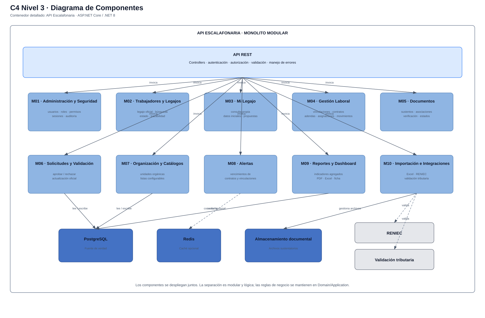

# Nivel 3 · Diagrama de componentes

> **Proyecto:** Sistema de Gestión Escalafonaria del Personal Municipal  
> **Contenedor detallado:** API Escalafonaria  
> **Modelo:** C4 · Nivel 3 de 4 · **Versión:** 1.0

---

## 1. Objetivo

Abrir el contenedor **API Escalafonaria** del nivel 2 y mostrar los componentes funcionales que forman el monolito modular, su responsabilidad y sus relaciones principales.

| Aspecto | Descripción |
|---|---|
| Pregunta que responde | ¿Cómo se divide el backend por dentro y qué hace cada componente? |
| Audiencia | Arquitectos y desarrolladores |
| Qué es un componente | Un conjunto de funcionalidades con una responsabilidad clara dentro del contenedor |
| Nivel anterior | `Nivel2-DiagramadeContenedores.md` |
| Siguiente nivel | `Nivel4-DiagramadeCodigo.md` |

---

## 2. Diagrama

---

## 3. Componentes

| Componente | Responsabilidad | Funcionalidades principales |
|---|---|---|
| **API REST** | Punto de entrada HTTP | Endpoints, autenticación, autorización, validación y manejo de errores |
| **M01 Administración y Seguridad** | Gestionar acceso al sistema | Usuarios, roles, permisos, sesiones y auditoría |
| **M02 Trabajadores y Legajos** | Gestionar el legajo oficial | Apertura, consulta, búsqueda, datos oficiales, estado e historial |
| **M03 Mi Legajo** | Portal del trabajador | Consulta propia, datos iniciales y propuestas de actualización |
| **M04 Gestión Laboral e Historial** | Gestionar trayectoria laboral | Vinculaciones, contratos, adendas, asignaciones, movimientos y periodos |
| **M05 Documentos Sustentatorios** | Gestionar documentos del legajo | Adjuntar, asociar, verificar, anular, reemplazar y controlar visibilidad |
| **M06 Solicitudes y Validación** | Gestionar propuestas del trabajador | Crear, aprobar, rechazar y conservar solicitudes |
| **M07 Organización y Catálogos** | Mantener estructura y listas de referencia | Unidades orgánicas y catálogos configurables |
| **M08 Alertas** | Detectar vencimientos | Contratos y vinculaciones próximos a vencer o vencidos |
| **M09 Reportes y Dashboard** | Explotar la información | Indicadores, ficha escalafonaria, PDF y Excel |
| **M10 Importación e Integraciones** | Migrar e integrar información | Excel, RENIEC y validación tributaria |

---

## 4. Relaciones entre componentes

| Origen | Destino | Descripción |
|---|---|---|
| Aplicación web | API REST | Invoca funcionalidades mediante HTTPS/JSON |
| API REST | M01–M10 | Invoca los casos de uso correspondientes |
| M03 Mi Legajo | M06 Solicitudes | Las propuestas del trabajador se gestionan como solicitudes |
| M06 Solicitudes | M02 Trabajadores y Legajos | Una aprobación puede actualizar información oficial |
| M04 Gestión Laboral | M07 Organización y Catálogos | Usa unidades, cargos y catálogos configurados |
| M05 Documentos | M02 / M04 / M06 | Asocia sustentos a entidades y operaciones del legajo |
| M08 Alertas | M04 Gestión Laboral | Evalúa vencimientos de vínculos y contratos |
| M09 Reportes | M02 / M04 / M07 | Consulta información oficial y agregada |
| M10 Integraciones | RENIEC / servicio tributario | Ejecuta validaciones externas desacopladas |

---

## 5. Relaciones con contenedores y sistemas externos

| Componente | Destino | Descripción | Patrón |
|---|---|---|---|
| Módulos funcionales | PostgreSQL | Persistencia de información oficial | Repository |
| M01 / M09 cuando corresponda | Redis | Caché opcional | Cache-Aside |
| M05 Documentos | Almacenamiento documental | Guarda y recupera archivos | Adapter / servicio de almacenamiento |
| M10 Integraciones | RENIEC | Validación de identidad | Adapter |
| M10 Integraciones | Servicio tributario | Validación externa autorizada | Adapter |

---

## 6. Reglas del monolito modular

| # | Regla | Motivo |
|---|---|---|
| 1 | Los componentes se despliegan juntos | La solución es un monolito modular |
| 2 | Las reglas del negocio permanecen en Domain/Application | Se evita acoplar reglas a ASP.NET Core o EF Core |
| 3 | Los módulos acceden a persistencia mediante contratos | Se aplica Repository e inversión de dependencias |
| 4 | Los servicios externos se encapsulan mediante adaptadores | Permite sustituir proveedores y tolerar indisponibilidad |
| 5 | El acceso funcional se valida en backend | La seguridad no depende de ocultar elementos en frontend |
