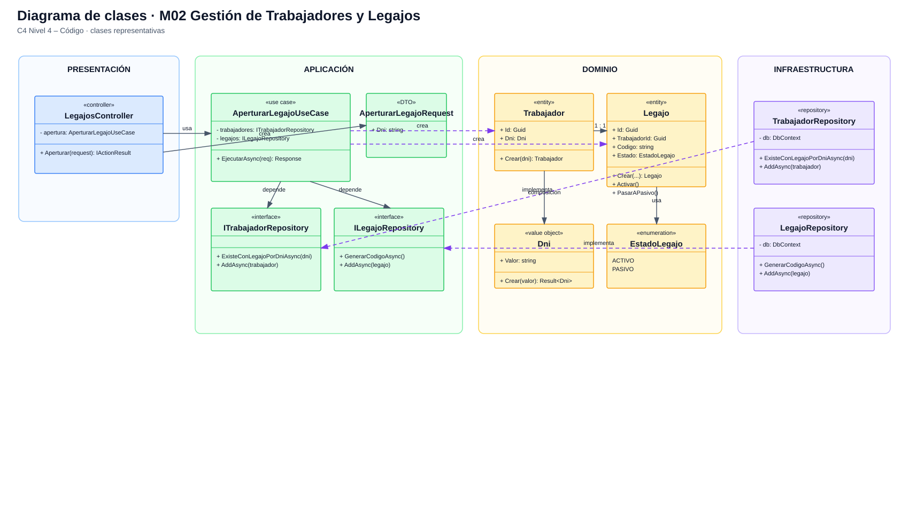
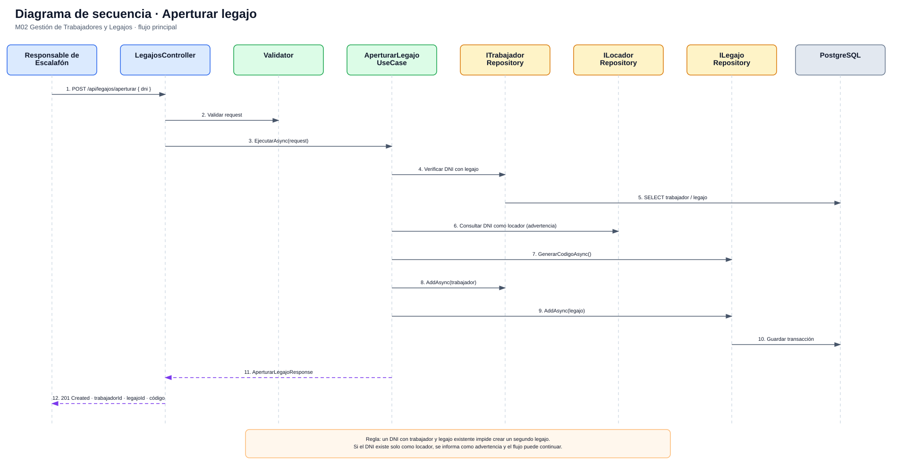

# Nivel 4 · Diagrama de código

> **Proyecto:** Sistema de Gestión Escalafonaria del Personal Municipal  
> **Módulo detallado:** M02 – Gestión de Trabajadores y Legajos  
> **Modelo:** C4 · Nivel 4 de 4 · **Notación:** UML · **Versión:** 1.0

---

## 1. Objetivo

Mostrar cómo se organiza el código de uno de los componentes más importantes del nivel 3, utilizando como referencia el flujo **Aperturar Legajo**.

| Aspecto | Descripción |
|---|---|
| Pregunta que responde | ¿Qué clases y contratos participan dentro del módulo y cómo colaboran? |
| Audiencia | Desarrolladores |
| Notación | UML: diagrama de clases y diagrama de secuencia |
| Módulo seleccionado | M02 – Gestión de Trabajadores y Legajos |
| Nivel anterior | `Nivel3-Diagrama-de-Componentes.md` |

---

## 2. Diagrama de clases

### 2.1 Capas de Clean Architecture

| Capa | Contiene | Regla |
|---|---|---|
| **API** | Controllers, filtros y middleware | Traduce HTTP y ejecuta casos de uso |
| **Application** | Casos de uso, DTO, interfaces y validadores | Coordina operaciones sin depender de tecnologías concretas |
| **Domain** | Entidades, value objects, enums y reglas | Contiene el núcleo del negocio |
| **Infrastructure** | Repositorios, DbContext y adaptadores | Implementa los contratos mediante tecnologías concretas |

> **Regla de dependencia:** Domain no depende de API ni Infrastructure. Application depende de Domain y utiliza contratos; Infrastructure implementa esos contratos.

---

## 2.2 Clases principales

| Clase / interfaz | Tipo | Capa | Responsabilidad |
|---|---|---|---|
| `LegajosController` | Controlador | API | Recibe la solicitud HTTP de apertura de legajo |
| `AperturarLegajoUseCase` | Caso de uso | Application | Coordina validaciones y creación de trabajador + legajo |
| `AperturarLegajoRequest` | DTO | Application | Transporta el DNI ingresado |
| `Trabajador` | Entidad | Domain | Representa al trabajador municipal |
| `Legajo` | Entidad | Domain | Representa el expediente escalafonario |
| `Dni` | Value Object | Domain | Valida y representa el DNI |
| `EstadoLegajo` | Enumeración | Domain | ACTIVO / PASIVO |
| `ITrabajadorRepository` | Interfaz | Application | Contrato de persistencia de trabajadores |
| `ILegajoRepository` | Interfaz | Application | Contrato de persistencia de legajos |
| `TrabajadorRepository` | Repositorio | Infrastructure | Implementa acceso a trabajadores mediante EF Core |
| `LegajoRepository` | Repositorio | Infrastructure | Implementa acceso a legajos mediante EF Core |

---

## 3. Diagrama de secuencia: aperturar legajo

| Paso | Origen → destino | Acción |
|---|---|---|
| 1 | Responsable de Escalafón → Controller | Envía DNI para aperturar legajo |
| 2 | Controller → Validator | Valida entrada |
| 3 | Controller → Use Case | Ejecuta el caso de uso |
| 4 | Use Case → ITrabajadorRepository | Verifica que no exista un segundo legajo para el DNI |
| 5 | Repository → PostgreSQL | Consulta información existente |
| 6 | Use Case → repositorio de locadores | Comprueba si el DNI existe como locador; solo informa |
| 7 | Use Case → ILegajoRepository | Obtiene/genera código de legajo |
| 8 | Use Case → ITrabajadorRepository | Registra trabajador |
| 9 | Use Case → ILegajoRepository | Registra legajo |
| 10 | Infrastructure → PostgreSQL | Persiste de forma consistente |
| 11–12 | Use Case / Controller → Responsable | Devuelve resultado exitoso |

---

## 4. Patrones y principios visibles

| Elemento | Patrón o principio |
|---|---|
| `ITrabajadorRepository` + `TrabajadorRepository` | Repository |
| Repositorios recibidos por el caso de uso | Dependency Injection |
| Infrastructure implementa contratos | Inversión de dependencias |
| Controller, caso de uso, entidades y repositorios separados | Responsabilidad única |
| Interfaces específicas | Segregación de interfaces |

> El detalle completo de estos elementos se encuentra en `diseño-de-software/diseño-interno/`.
